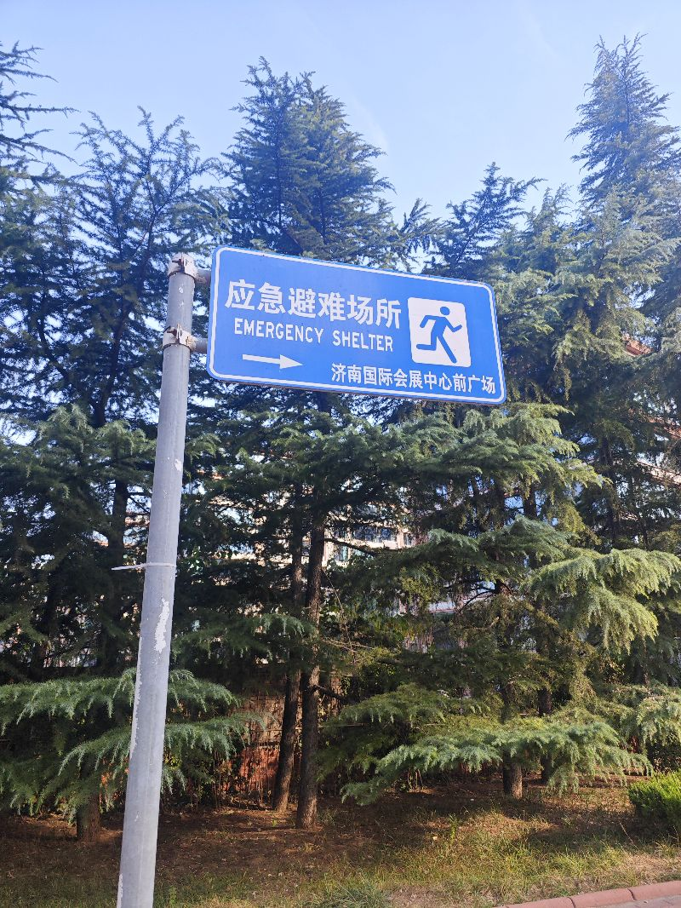
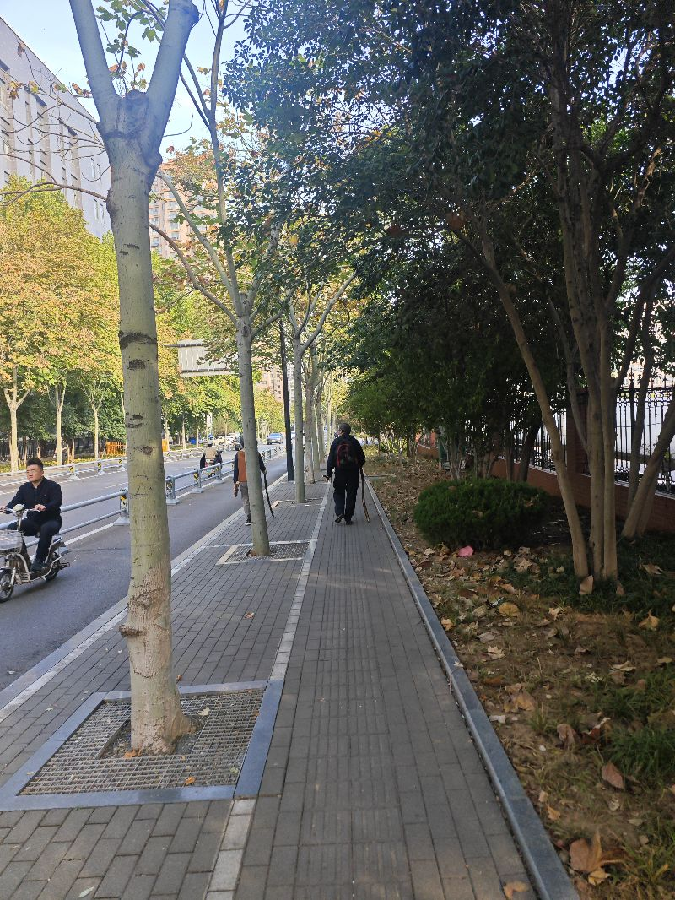

啊，现在每天都在看各种的关于人工智能的一个视频啊，一些学习的东西，感觉有些焦虑，为什么呢，好像是这个二十智能，现在强盗已经可以决定我们的这个未来了，而在这个情况下呢，自己不在牌桌上，如像自己说的那句话，就果自己不在牌桌上，那么一定定成为为百个的丑化，现实中我们已经是筹码了，对自己的人工地方都没有掌控，然别刚才在听到那个扎克伯格型x王已经在做这个这个这个明发的这个经历，就会感觉到就是六十王明明是一个中国人，呃，然后二十四岁成为百万富翁，二十八岁成为百万富翁，靠的是什么，靠的就是这个经验和大脑，他甚至没有做过任何一次大模型的情况下啊，就对扎克伯格委以重任，他为什么能够就像现在呃麦a系列的s这个系列在疯狂的排挤，中国人根本没有办法使用，而扎克伯格却要堵在一个华裔的身上呢，这个时候我深思的恰恰就是为什么我们活的这样像老鼠一样，而他们却愿意就像这个，一只老鼠生反相信，如果阿莱王王最印度人，而印度和美国是高对抗的，大概率不会发生这种合作，而中国人却可以，这们为什么对自己的母体失去了这种依存关系，他为什么不再爱自己的这个妈热烂的，我深世的是这个点，我觉得恰恰是因为相对的他找不到归属，而mar热烂的各种表现好像也不爱对他有吸归属，而曾经生活得过的那些地方，更他带不起归属感，我觉让让我非常常常痛的一点点，如何让自己的妈妈更他依存的民，他才是我们应该研究的最核心的点，因为你的强大，真正的强大是每一个人都过上更好的生活，而永永应该以这个个点为核核心，因为以这个点为核心点，所有的所有所所有的发展，所所可以积累的所有来恰恰是本末倒置，

🎙️ 原始录音：

<audio controls src="audio.m4a"></audio>

