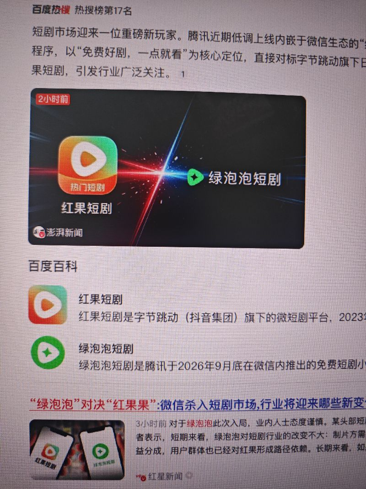

简单看了一下绿泡泡据说要对抗红果的两亿越火，感觉难度很大，为什么绿泡泡首先是一个小程序，它的打开其实是挺麻烦的，第二呢就是短剧胜出，真正靠的是爆款，短剧一个a p p是否拥有独家的爆款，我相信红果做这个并不难，为了是绿泡泡，做这个并不难，也就是腾讯体系并不难，现在难的是红果上有很多这种爆款剧，当然对于做内容的这点上不算什么太样的难准，只要坚持总能够达到同样的水准，还有就是操作习惯，绿泡泡打开之后，跟红果的操作习惯差异挺大，上去的那套展示各方面它都放到了中间，忘了是绿，当下来看，我并不太看好绿泡泡，我觉得它大概率又是一个失败的产品，忘像我现在做的短产品，二呢呢在相关的维度上面，红果竞争没有任何胜出之处，所以从刚开始做的，其实就不是短剧，所能以这种方式来定位，在以其他方面做执行，才有可能赚到钱，

