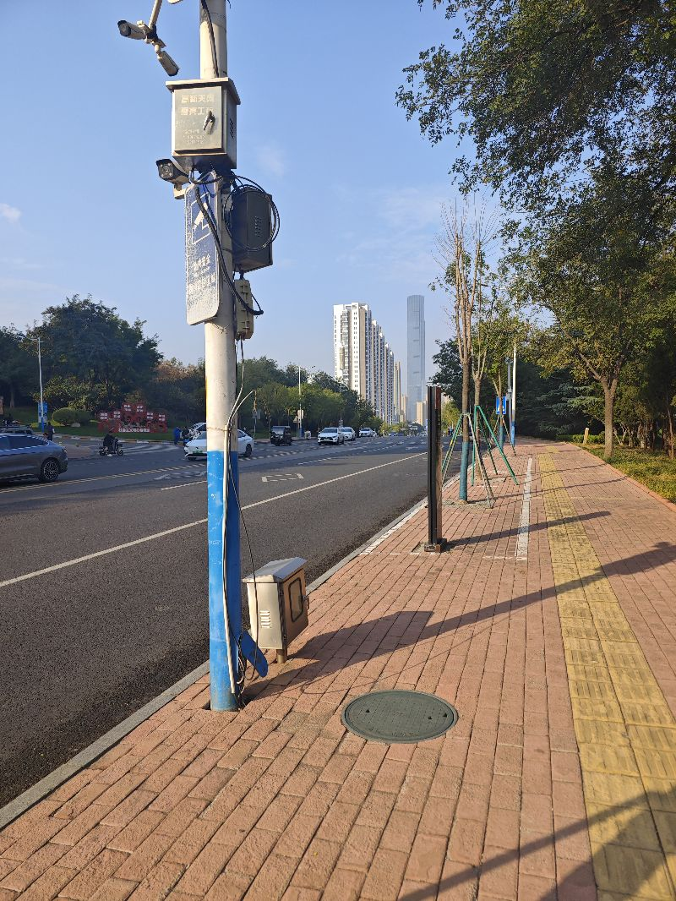
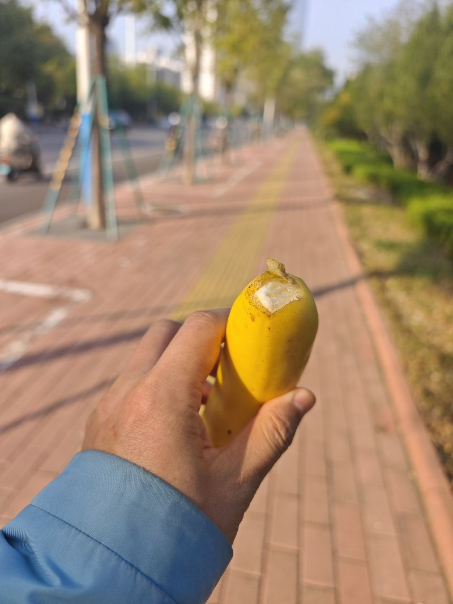

到底经济怎么样？如果看早晨出门路上的车，差距很大很大。当然，我认为主要原因还是济南通地铁了，因为地铁分走了很多的人流量。但是现在，赚钱的公司很赚，不赚钱的举步维艰，很多公司都在生死线上。也就是说，利润高的吓人，甚至说为了明天更好的发展，现在在等待新的机会；而有些公司则大赚特赚。很多人当然更厉害，最可怕的就是一个人赚的钱，比一百个人一起赚的还多，形成团体赚钱的流动。这样的东西如果不能够减少或者说改善，再积累下去，我很难想象是一种什么样的境界。来个香蕉吧。

