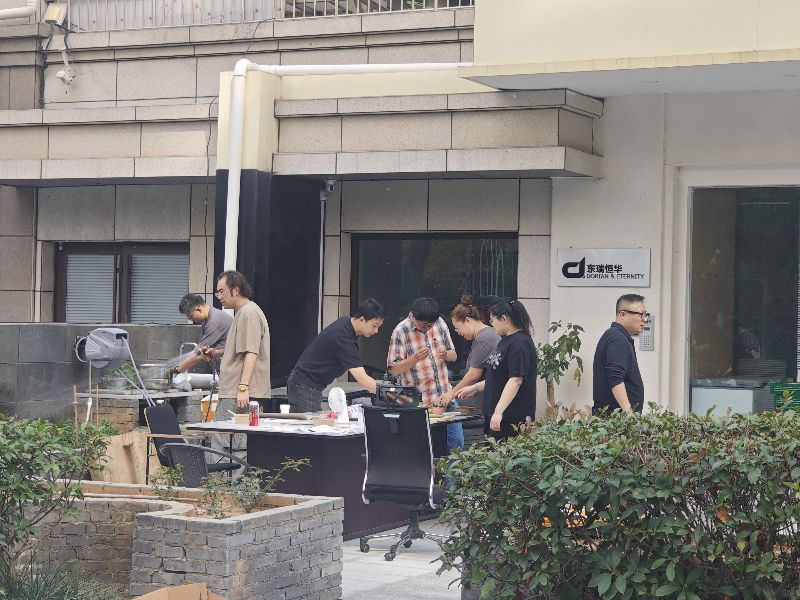
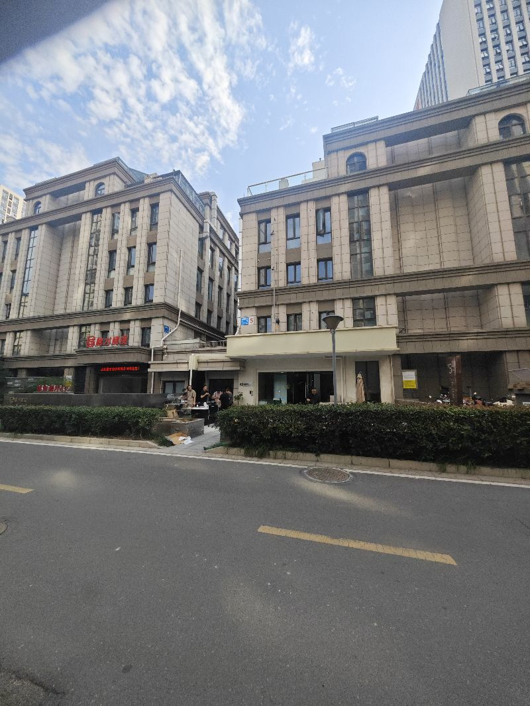
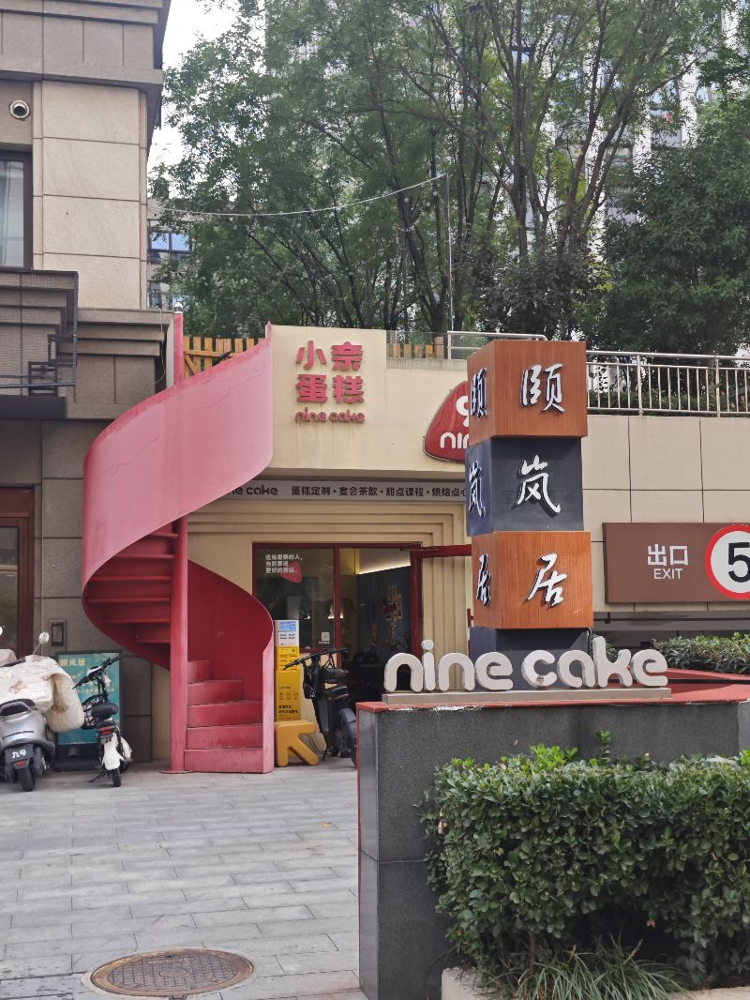

看到一家公司正在吃饭，太羡慕了。你看这种才叫爽呢，就在自己公司楼下，太方便了。有时候在时东瑞恒华，太有意思了。旁边又开了一家披萨店，这个难度很大，因为在他旁边已经有一家做了很长时间的蛋糕店了。经济该怎么发展？有的时候就会觉得，不管干什么都很难，但同时机会又永远存在，一切都在于自己的经营水平。如果分配的足够多，大家都不用太忙就可以；但如果流动的很少，分到手里的只有一点点，那么整个内卷将会逐渐加剧。

