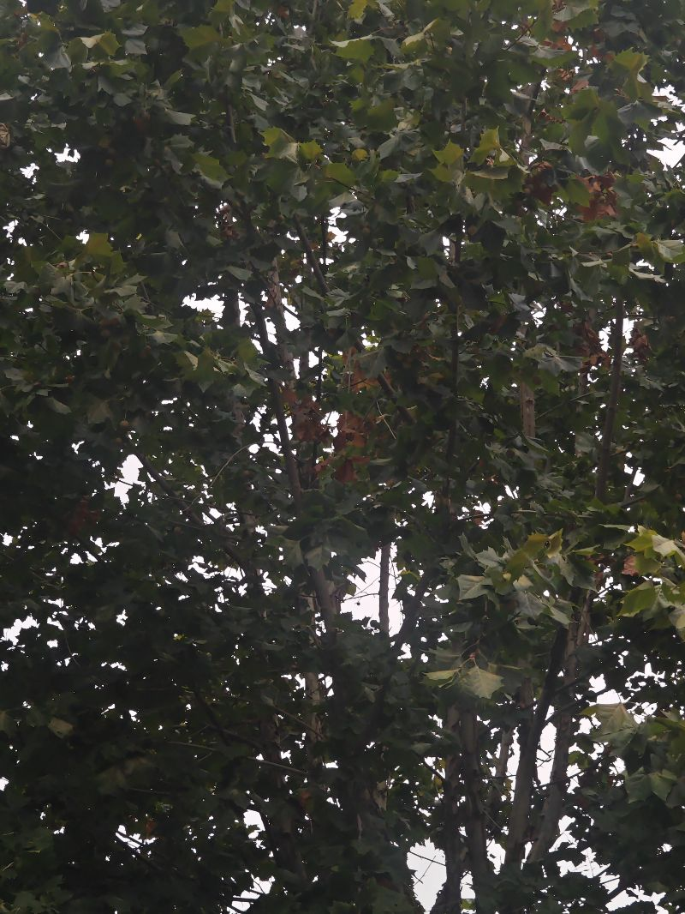

秋天真的被耽误了，想做的事情太多了。时间过得太快，人类就这样春去冬来，我们还能有多少时间？真的希望人工智能可以发展得更快一点，让我们能够实现永生，想生则生，想死则死，这样的人生才有更大的可能性。

当然，每个人都会有一种妄想，可能当我们能够活到一千岁的时候，又会想活到一万岁。现在的问题是，还没有感觉到青春该做什么，青春就过去了。等到后悔的时候，才发现被耽误了。我们最怕这种错误的堆叠，人生拥有太多的遗憾。但希望人工智能能够让人活出第二春。

每个人都能活出第二春的时候，希望永生不单单是永生，而是有一个第二春，有一个再来一次的机会。我相信这个世界将会非常美好。当然，也可能有人选择作恶，比如说把两种人生都过一遍。希望人人……每个人可能就很容易被惩戒了，因为既然第一春死去可以复活，那很多人就不怕了。这个世界应该是更美好的。

