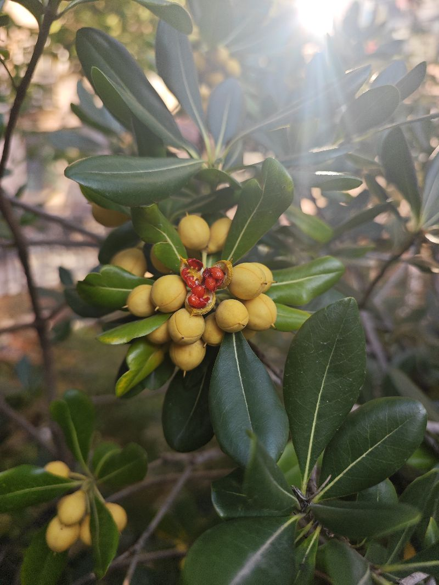

冬天真的是来了，最近早晨特别的冷，也只有这种四季常青的这种植物，我能够绽放出笑颜的感觉，济南的春天和冬天都是这种，昨天还是下一个季节，今天就是下一个季节的感觉，今年的夏天，我基本上是这非常忙乱的过程中度过的，也就是说，从六月份到九月份，这该热的季节里面，我忙碌的没有感觉，我甚至今觉这几个月好像失去了我就是人在极度关心某件事情的时候，很容易丧失自我，我就是这种感觉，这其实我们每一天都应该去感受我们的环境，然后做出最佳的选择，但是呢看到那些特种兵，他们退伍之后的表现，不能想象出在一种最高强度的专注中，我们去感受思感到那种周边人能怎么样重要的表境去是是，我的极速成长营最应该最有价值的地方，就是因为他强迫自己用一种每天反思的角度来思考自己的重要方面，这也恰恰告诉我啊，我们应该每在增加一项是对环境的感知，这样一个成长营的关键项，也就是说，至少我知道今天是几号，今天发生了什么，今天的天气如何，我在这个天气中，在这个场景下的感受如何啊，又是一项很大的收获，好吧，就到这里，

